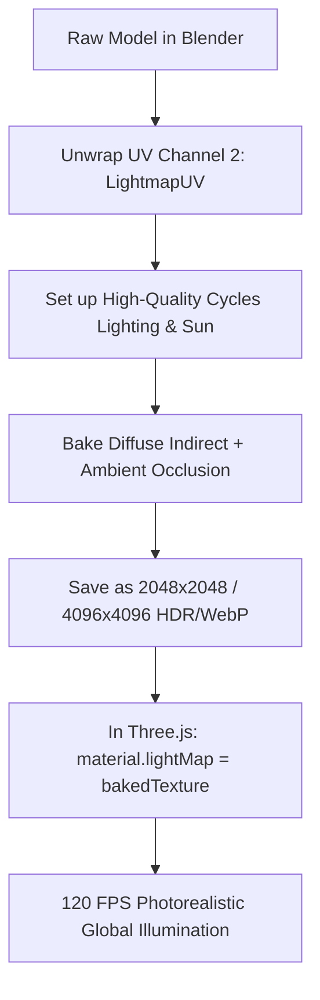

# The Awwwards & Lusion Playbook: Hyper-Realistic WebGL Realism & Zero Frame Drop

> **Target**: Transforming raw 170MB CAD/BIM architectural models into an Awwwards Site of the Year 60–120 FPS photorealistic WebGL experience.

---

## 1. Executive Summary: Why Raw 170MB GLBs Drop Frames & How Top Studios Win

Studios like **Lusion, Active Theory, Merci-Michel, and Little Workshop** do not render complex architecture with unbaked real-time lights and raw geometry. In real-time WebGL:
- **Draw Calls**: Every individual mesh and unique material trigger a CPU-to-GPU draw call. Your raw model currently has **511 meshes and 248 materials** (~750 draw calls per frame). 60 FPS requires under **40–60 draw calls**.
- **Geometry**: 170MB contains millions of un-instanced, non-retopologized CAD vertices, including interior faces inside walls, screws, and hidden geometry.
- **Lighting**: Real-time WebGL can calculate direct light, but **cannot compute indirect bounce light (Global Illumination), soft contact shadows, or ambient color bleeding** without tanking performance.

### The Secret Weapon
Top studios achieve photorealism by **baking Cycles offline path-traced lighting into UV Channel 2 lightmaps**, merging static meshes by material, and compressing textures into **KTX2 GPU formats**. The browser merely displays the pre-calculated light with a simple multiply shader at 120 FPS.

---

## 2. Step-by-Step Blender Optimization Pipeline

### Phase A: Mesh Cleanup & Polygon Budgeting
1. **Remove Hidden & Redundant Faces**:
   - In Blender Edit Mode, select all geometry (`A`), go to **Mesh > Clean Up > Delete Loose** and **Mesh > Clean Up > Degenerate Dissolve**.
   - Delete all geometry inside solid walls, slabs, under furniture bases, or behind closed cabinetry that the camera will never see.
2. **Merge Meshes by Material (Drastic Draw-Call Reduction)**:
   - Group objects sharing the same material (e.g. all wooden floorboards, all window frames, all ceiling panels).
   - Press `Ctrl + J` to join them into single contiguous meshes.
   - Target: Reduce 511 meshes down to **15–30 merged meshes**.
3. **Instancing for Replicated Assets**:
   - For dining chairs, spotlights, balcony railings, door handles, and barstools: use **Linked Duplicates** (`Alt + D` instead of `Shift + D`) or export with glTF extension `EXT_mesh_gpu_instancing`.
   - Three.js will render 50 chairs in a **single draw call** using GPU instancing.

---

### Phase B: The Holy Grail — Baking Cycles Lightmaps (UV Channel 2)

Offline lightmap baking is how architectural showcases look like V-Ray / Corona / Cycles renders on the web.



#### Step-by-Step Lightmap Bake in Blender:
1. **Create UV Channel 2**:
   - In Object Data Properties (`Object Data > UV Maps`), click `+` to add a second UV map named `LightmapUV`.
   - In Edit Mode, press `U > Smart UV Project` (Island Margin = `0.008` to prevent bleeding).
2. **Setup Cycles Engine**:
   - Render Properties > Render Engine: **Cycles** (GPU Compute).
   - Samples: `512` to `1024` with **OpenImageDenoise** enabled.
   - Set up your realistic architectural sun, HDRI sky, and interior warm spotlights.
3. **Bake Settings**:
   - Scroll down to the **Bake** panel in Render Properties.
   - Bake Type: **Diffuse** (Check *Indirect* and *Direct*, uncheck *Color* if baking pure lighting, or choose **Combined**).
   - Margin: `16px`.
   - In the Shader Editor, create an empty **Image Texture** node (e.g., `Penthouse_Lightmap_4K.exr` or `.png`), select it (keep it active/unconnected), and click **Bake**.
4. **Export with UV2**:
   - When exporting to GLB, ensure **Data > Mesh > UVs** is checked.
5. **Three.js Implementation**:
   ```javascript
   const lightmapTexture = textureLoader.load('/textures/penthouse_lightmap.webp');
   lightmapTexture.channel = 1; // Uses UV Channel 2
   lightmapTexture.flipY = false;

   mesh.material.lightMap = lightmapTexture;
   mesh.material.lightMapIntensity = 1.4;
   ```

---

### Phase C: PBR Texture Packing (ORM Workflow)

In standard WebGL, loading separate Roughness, Metallic, and Ambient Occlusion maps requires 3 image decodes and 3 texture samplers.

- **Pack into a Single ORM Texture**:
  - **Red Channel**: Ambient Occlusion (AO)
  - **Green Channel**: Roughness
  - **Blue Channel**: Metalness
- In Three.js:
  ```javascript
  const ormTexture = textureLoader.load('/textures/materials_orm.webp');
  material.aoMap = ormTexture;
  material.roughnessMap = ormTexture;
  material.metalnessMap = ormTexture;
  ```

---

### Phase D: KTX2 / Basis Universal Compression (VRAM Elimination)

> [!WARNING]
> A 170MB GLB with PNG/JPG textures will decompress into **over 1.2 GB of GPU VRAM**, causing mobile Safari and Android Chrome to crash due to memory pressure.

- **Why KTX2 (ETC1S / UASTC)?**
  KTX2 textures are uploaded directly to the GPU in block-compressed format (BC7 on PC, ASTC on Mobile).
  - VRAM consumption drops by **75%–85%**.
  - Texture load and parse time drops from 4 seconds to **0.05 seconds**.
- **One-Command glTF Pipeline Compression**:
  Using `@gltf-transform/cli`:
  ```bash
  # 1. Deduplicate & optimize geometry
  gltf-transform dedup input.glb stage1.glb
  gltf-transform prune stage1.glb stage2.glb

  # 2. Compress geometry with Draco or Meshopt
  gltf-transform meshopt stage2.glb stage3.glb

  # 3. Compress textures to KTX2 / UASTC
  gltf-transform uastc stage3.glb output_optimized.glb
  ```
  *Result: Your 170MB file will shrink to **12MB – 18MB** with virtually identical visual fidelity!*

---

## 3. Dedicated Collision Mesh for First-Person Walkthrough

Instead of running CPU raycasts against 500,000 architectural polygons:
1. In Blender, build an invisible low-poly convex cage (walls, floors, doorways) using simple boxes.
2. Name the object `_collision_cage`.
3. In Three.js:
   ```javascript
   // Raycast or bounding box checks only against this 200-polygon mesh!
   if (child.name.includes('_collision_cage')) {
     child.visible = false; // invisible in render
     collisionMeshes.push(child);
   }
   ```

---

## 4. Post-Processing & Lighting Polish Checklist

| Technique | Implementation | Impact |
| :--- | :--- | :--- |
| **Tone Mapping** | `ACESFilmicToneMapping` with exposure ~1.2 | Film-grade highlight rolloff without blown-out whites |
| **Bloom** | `UnrealBloomPass` (strength: 0.25, radius: 0.4, threshold: 0.85) | Subtle glow on lighting fixtures and sunset glints |
| **Anti-Aliasing** | `SMAAPass` or `TAA` (Temporal Anti-Aliasing) | Ultra-clean architectural edges without edge shimmer |
| **Dithering** | `material.dithering = true` | Eliminates banding in subtle wall and sky gradients |
| **Color Grading** | Subtle warm LUT / 3D Look-Up Table | Consistent luxury aesthetic across all displays |

---

## 5. Architectural Alignment Coordinates Saved

The app includes an integrated live calibration drawer (`H` key). The penthouse floor and building share world-space coordinates:
- **Floor Elevation**: `Y = 29.90 m`
- **Eye Height**: `Y = 31.55 m`
- **Horizontal Bounds**: `X: [5.2, 35.8], Z: [-3.8, 23.5]`
- **Hotspot Coordinates**:
  - Grand Foyer: `(12.0, 31.55, 3.0)`
  - Grand Living Lounge: `(18.5, 31.55, 8.5)`
  - Dining & Sky Bar: `(26.0, 31.55, 6.5)`
  - Master Suite: `(27.5, 31.55, 17.5)`
  - Panoramic Sky Balcony: `(9.0, 31.55, 18.0)`
